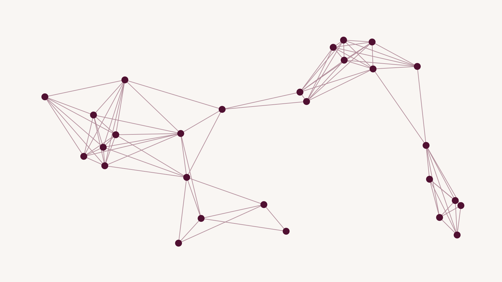

*Sample article for site testing; replace before launch.*

Read this sentence: "The trophy did not fit in the suitcase because it was too big." What does "it" refer to? You know instantly that it is the trophy, because suitcases being too big would not stop anything from fitting. Now change one word: "because it was too small." Now "it" is the suitcase. Nothing about the word "it" changed. What changed is which other words it needs to be read alongside.

That problem, deciding which words matter for understanding a given word, is what the attention mechanism solves. It is the core of the transformer architecture introduced in a 2017 paper from Google titled "Attention Is All You Need," and every major language model since has been built on it.

## Before attention

Earlier language models read a sentence one word at a time, left to right, carrying a running summary in memory. By the time such a model reached "it," the summary had to contain everything relevant about "trophy" and "suitcase," compressed into a fixed-size bundle of numbers. Long sentences got fuzzy. Anything far back in the text was effectively forgotten.

## The mechanism

Attention throws away the running summary. Instead, every word gets to look directly at every other word in the text and ask: how relevant are you to me?

Each word is first turned into a list of numbers, a vector, that encodes something about its meaning. From that vector, the model computes three more vectors, which the paper calls the query, the key, and the value. The names are borrowed from databases, and the analogy is decent.

- The query is what this word is looking for. For "it," the query might encode "I am a pronoun; I need a noun to refer to."
- The key is what each word advertises about itself. "Trophy" and "suitcase" both have keys that say, roughly, "I am a concrete noun."
- The value is what a word contributes if it is chosen.

The model compares the query of one word against the keys of all the others. Words whose keys match the query well get a high score; the scores are scaled into weights that add up to one. The word's new representation is then the weighted sum of everyone else's values. "It" ends up being mostly made of "trophy" or mostly made of "suitcase," depending on which key matched better, and the words "big" or "small" tip the balance.

*Each word draws a weighted connection to every other word. Thicker lines are higher attention.*

> Attention is a vote. Every word in the sentence gets a say in what every other word means.

None of these rules are written by a person. The query, key, and value transformations are learned by training on enormous amounts of text: the model adjusts them until the predicted next word is right more often. The rule "a pronoun should attend to the noun that makes physical sense" is not coded anywhere. It emerges because models that attend that way predict text better.

## Why it scaled

Two properties made attention win. First, it runs in parallel. Every word computes its attention at the same time, which is exactly what graphics processors are good at, so the models could grow. Second, the distance between two words no longer matters. Word one and word five thousand connect in a single step, which is why modern models can hold a whole book in context.

Real transformers stack dozens of attention layers, run many attention "heads" side by side so different heads can learn different relationships, and interleave them with ordinary neural network layers. But the trophy-and-suitcase problem is the heart of it. A model that can figure out what "it" means, at any distance, in parallel, has most of what it needs to write.

## What attention does not do

It is easy to read too much into the word. A model attending strongly from "it" to "trophy" is not understanding in any human sense; it is computing a weighted average that has, over training, come to correlate with the right answer. Researchers who study these weights have found that some attention heads track grammar, some track position, and many do things nobody has yet named. The mechanism is transparent in the sense that you can print the weights. It is opaque in the sense that the weights do not explain themselves. That gap, between a mechanism we can fully write down and behavior we cannot fully predict, is one of the central open problems in the field.

